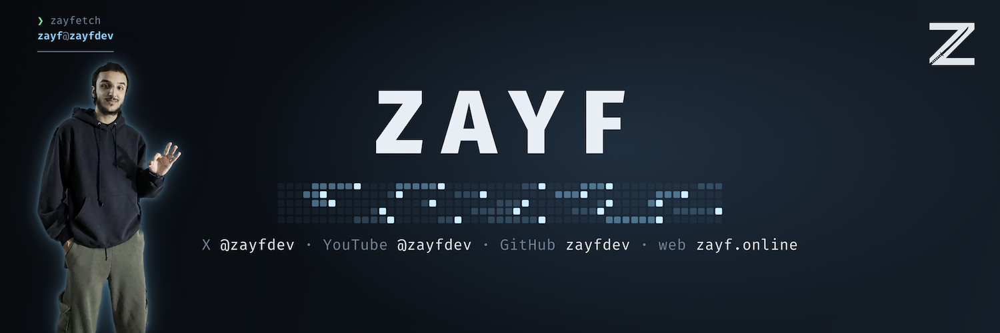

### Hey, I'm Zain

Software engineer. I build AI products from first commit to paying users, and share how I build them: the tools, the agent setup behind them, and what breaks along the way.

**Built:** CTO and sole engineer of KreatorFlow (2025–2026), an AI image and video SaaS I built and ran alone to about $10K MRR: 1,278 commits, 406 API routes, Stripe and crypto billing, serverless GPUs, and a public developer API. While there, I set up its official partnership with BytePlus (ByteDance's enterprise AI arm) and worked with their engineers and leads to take Seedream and Seedance into production. I left in 2026 and kept the rights to the code I wrote.

**Client work:** redesigned and rebuilt the whole Shopify store for [Awards & Engraving Florida](https://ae-florida.com/), every page of it, including a trophy configurator, a tracked quote flow and an in-browser ML photo personalizer.

**Building:**
- **AnimeFlow**: a desktop anime player that upscales video with AI while it plays. TensorRT super-resolution plus my own GLSL shaders, 26.8 ms per frame on one RTX 4060, with no dropped frames.
- **Penwise**: a pen-first notebook for my Galaxy Tab S9. A Rust ink engine draws strokes bit-identically on tablet, browser and PC, with live sync and MCP tools so AI agents can read and annotate my pages. Open source, with a demo, soon.
- **My agent setup**: Claude Code, Codex, omp, Factory and pi alongside harnesses I've built myself, around one system of about 100 skills, agent roles, rules, hooks and verification gates. It's how I build everything above.

**Stack I reach for:** TypeScript · Rust · Python · SQL · Next.js · Postgres · AWS · TensorRT · Stripe

[zayf.online](https://zayf.online) · [YouTube](https://youtube.com/@zayfdev) · [X](https://x.com/zayfdev) · hello@zayf.online
